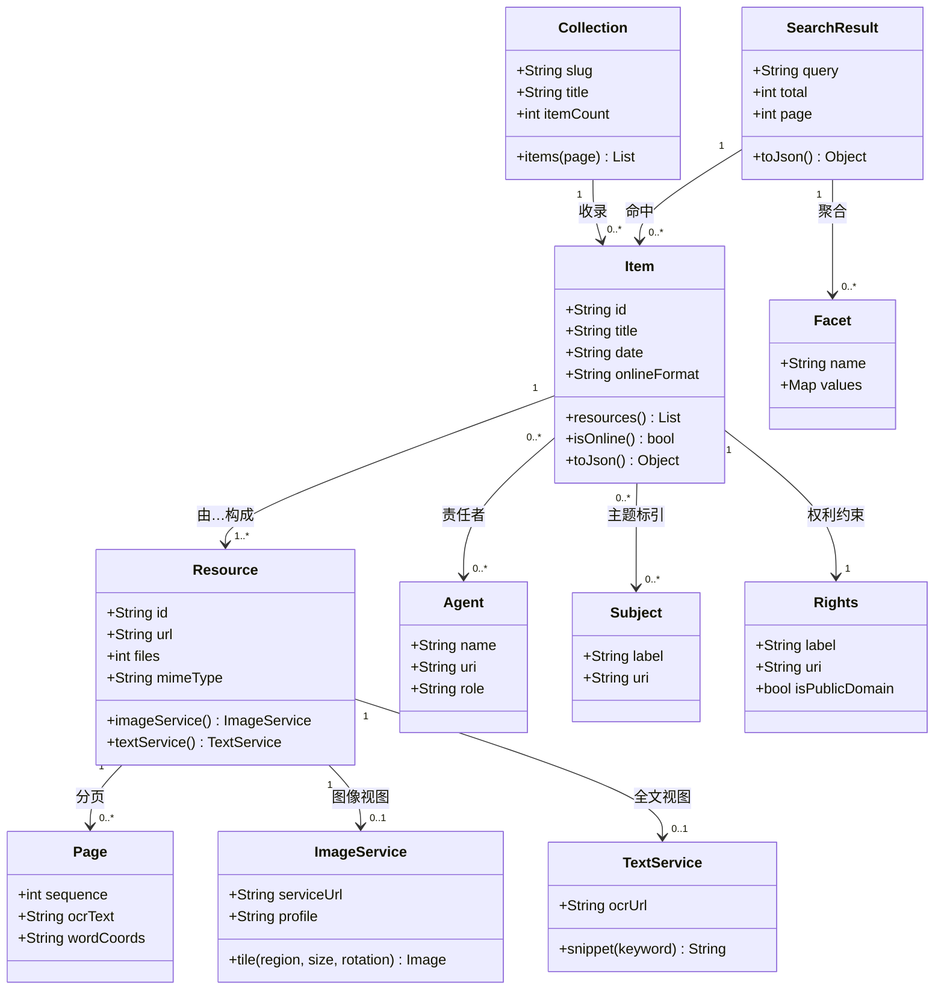
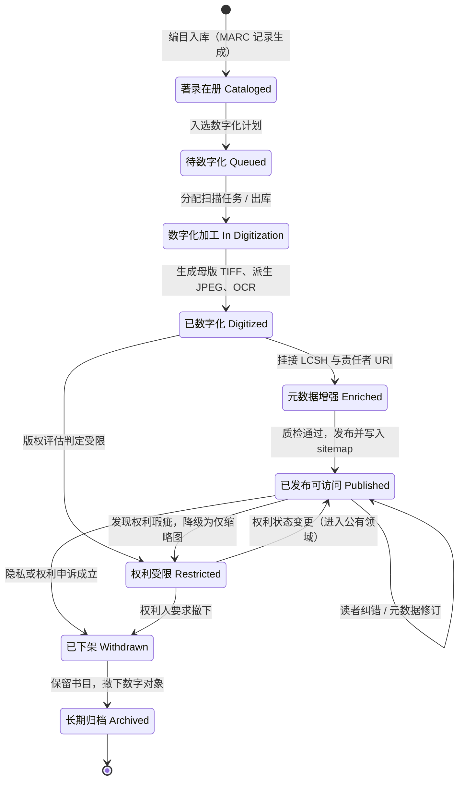
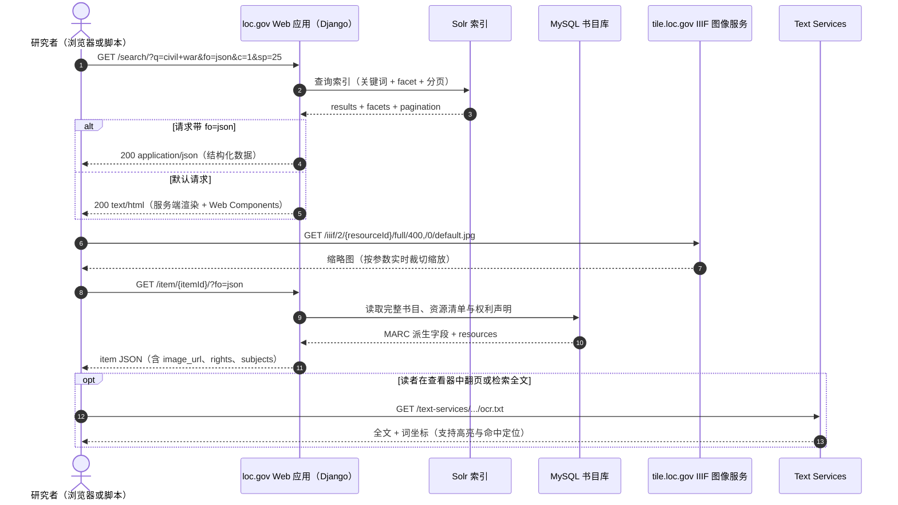
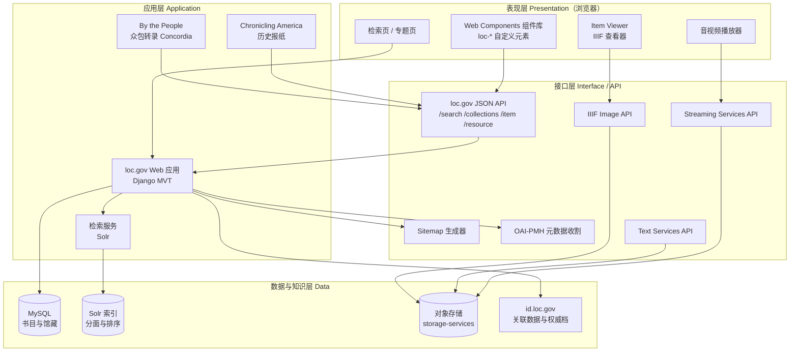

# 美国国会图书馆官网 loc.gov 系统分析

> 基于领域对象建模、系统应用架构设计与接口层设计的视角
>
> 学号：2441502005　姓名：徐吉涛　日期：2026-11-13
>
> 分析对象：<https://www.loc.gov/>

本文以课程第四章"领域对象建模、系统应用架构设计、接口层设计"的原则为框架，对 loc.gov 的公开技术资料与实际请求行为做逆向分析。所有技术判断标注证据来源，图形以 Mermaid 绘制。

---

## 一、分析对象与取证

### 1.1 站点定位

loc.gov 是美国国会图书馆（Library of Congress）的主站，同时承担三重角色：**面向公众的数字馆藏门户**、**面向研究者的机器可读数据源**、**面向第三方系统的接口提供方**。这一定位决定了它不能只是一个"网页"，而必须是"网页 + 接口 + 微服务"的组合体。

### 1.2 可验证的技术事实

以下事实来自馆方公开的技术说明、API 文档与站点实际返回的资源地址，而非推测：

| 层面 | 事实 | 证据来源 |
| :--- | :--- | :--- |
| 后端语言与框架 | Python + Django Web 框架 + Apache HTTP Server + MySQL | 馆方《Prints & Photographs Online Catalog》技术说明 |
| 检索 | Apache Solr / Lucene，检索定制逻辑用 Java 编写 | 同上 |
| 前端 | 服务端渲染 HTML，浏览器端以 Web Components 自定义元素渐进增强 | 站点页面结构与前端资源组织 |
| 主接口 | loc.gov JSON API：在原 URL 后加 `?fo=json` 即返回结构化数据 | <https://www.loc.gov/apis/> |
| 图像接口 | IIIF Image API（国际图像互操作框架），支持区域裁切、缩放、旋转 | <https://www.loc.gov/apis/micro-services/image-services/> |
| 文本接口 | Text Services：提供 OCR 全文、词坐标与上下文片段 | <https://www.loc.gov/apis/> |
| 流媒体接口 | Streaming Services：音视频投递，域名 `tile.loc.gov` | 首页视频源 `tile.loc.gov/streaming-services/iiif/…` |
| 对象存储 | `tile.loc.gov/storage-services/…` 存放派生数字对象 | 首页媒体资源实际地址 |
| 关联数据 | id.loc.gov 提供权威档与受控词表的可解析 URI | <https://id.loc.gov/> |

这组事实已勾勒出清晰轮廓：**Django 单体应用 + Solr 检索 + 三类专用微服务 + 一套统一的内容协商 API**。下文分析都建立在这个轮廓上。

---

## 二、领域对象建模

### 2.1 领域对象的识别

用名词分析法从"读者检索、打开、查看一件馆藏"的场景中提取名词，按职责合并同类项，得到六个核心领域对象：

- **馆藏集合 Collection**：如"南北战争地图"，对外以 kebab-case 短名标识（`/collections/civil-war-maps`）。
- **馆藏项 Item**：书目意义上"一种资料"，对应一条 MARC 记录派生出的对象。
- **数字资源 Resource**：Item 的数字化呈现，一个 Item 可有多个 Resource（不同卷、不同格式）。
- **页 Page**：Resource 的分页单元，报纸、手稿类对象才有。
- **责任者 Agent / 主题词 Subject**：不作为字符串字段，而作为可解析的 URI 对象。
- **权利声明 RightsStatement**：决定对象是否公开、能否下载。

另有三个**接口层对象**：SearchResult、Facet、ImageService。它们不是业务实体，而是接口契约的载体，必须与领域实体分开建模——这正是接口层设计的基本要求。

### 2.2 类图

### 2.3 三个关键建模决策

**其一，Item 与 Resource 分离。** 这是数字图书馆最重要的建模判断。一本书的书目信息（题名、责任者、主题）只有一份，但它的数字副本可能有多个：整本 PDF、逐页 JPEG、OCR 文本、音频朗读。若把两者合成一个类，就会出现"一书多格式时字段重复膨胀"。分离后 Item 对 Resource 是 1 : 1..*，格式增加不影响书目层。

**其二，Subject 与 Agent 用 URI 而不是字符串。** 主题词指向 id.loc.gov 的 LCSH 受控词表，责任者指向权威档。"南北战争"在系统中是一个**可解引用的标识符**而非一段文本，于是跨库聚合、同名作者消歧、多语言映射成为可能；代价是写路径必须维护 URI 有效性。

**其三，Rights 作为独立对象而非布尔标志。** 版权状态不是"能看/不能看"两态，而是 rightsstatements.org 定义的一组标准声明。做成对象才能承载 URI 与说明文本，也才能支撑状态图中"受限 → 公开"的迁移。

### 2.4 领域模型与接口响应的对应

loc.gov 检索接口的响应固定为三段：`pagination`、`facets`、`results`。这不是随意设计的字段，而是三个对象在接口层的投影：SearchResult 承载分页，Facet 承载聚合，`results` 里每一条都是 Item 的摘要视图。领域模型与接口契约结构一致，使得"加字段"这种需求不需要改动接口骨架。

---

## 三、状态建模

### 3.1 状态图

### 3.2 状态划分的依据

状态不是"流程步骤"的清单，而是**对象的可观察属性在一段时间内保持不变的区间**。图中每个状态都对应一组稳定的属性组合：

- **著录在册**：有 MARC 书目记录但无数字对象。用户能在检索结果看到题名，点进去没有图像。
- **待数字化 / 数字化加工**：内部作业状态，对外不可见，是图中唯一"不产出可见行为"的一段。
- **已数字化 → 元数据增强**：有图像但主题词、责任者尚未与 id.loc.gov 对齐。此时对象可能已能被检索，但聚合质量差。
- **已发布可访问**：对外契约的兑现点——页面可访问、JSON API 可查、IIIF 图像可缩放。
- **权利受限**：元数据与缩略图仍在，高清图与全文关闭。它与"已发布"是**同一对象的两种可见性等级**，不是前后相继的两步，因此保留双向迁移。

### 3.3 两处容易漏掉的处理

**自环表示续期式变更。** "已发布 → 已发布"的自环代表读者纠错、元数据修订：状态名不变，版本与更新时间变化。很多建模会漏掉自环，导致"修订"这个高频事件无处安放。

**异常出口必须显式建模。** "已发布 → 已下架 → 长期归档"处理的是隐私申诉、权利瑕疵、数字对象损坏。若不画出，系统遇到下架需求只能"删数据"，而图书馆的合规要求恰恰是"撤下内容但保留书目"。

---

## 四、交互建模

### 4.1 交互图

### 4.2 最经济的一笔设计：一个 URL，两种表示

图中 `/search/?q=civil+war` 这个请求，浏览器拿到 HTML，程序加上 `&fo=json` 拿到 JSON。**URL 标识资源，`fo` 参数标识表示形式**——这是 HTTP 内容协商的经典做法，也是 loc.gov 架构里最省成本的决定：不用维护两套接口、两套文档、两套权限，网站自己就是自己的 API。

官方文档的表述很直接：这个 API "originally designed to power the loc.gov website"（最初就是为了驱动自家网站而设计）。这提示了一条重要经验：**把内部需求抽象成接口，外部能力就自然获得**。相反，先做私有内部调用、再补一套对外 API，必然导致两份逻辑长期漂移。

### 4.3 按需派生，而非预生成

交互图下半段是 IIIF 的调用方式：`/iiif/2/{id}/full/400,/0/default.jpg`。缩略图不是事先批量生成，而是**按请求参数实时裁切缩放**。两点收益：存储成本从"每个对象 N 种尺寸"降为"一份母版"；前端可按设备像素比自由取图，不必预设尺寸阶梯。

与之呼应的是 Text Services：全文与词坐标同样按需返回。三个服务（图像、文本、流媒体）的共同点是——**都只做"对同一数字对象的某种变换"**，边界极其清晰。

---

## 五、构件图与软件架构体系

### 5.1 构件图

### 5.2 架构风格判定

| 架构风格 | 在 loc.gov 中的体现 | 判定 |
| :--- | :--- | :--- |
| 分层架构 | 表现层 → 接口层 → 应用层 → 数据层，跨层调用被接口层阻断 | **成立**，四层职责清晰 |
| 前后端分离 | 前端组件通过公开 API 取数，不依赖后端模板内部结构 | **部分成立**，首屏仍服务端渲染，属渐进增强 |
| 服务化 / 微服务 | 图像、文本、流媒体三个专用服务独立部署在 tile.loc.gov 等域下 | **成立**，属"能力型微服务" |
| 共享数据库反模式 | 主应用与微服务不共享 MySQL，微服务只读对象存储 | **未出现**，边界守得住 |

### 5.3 微服务边界是怎么划的

这是整份分析最值得学的一点。loc.gov 没有按"业务模块"切服务（如检索服务、借阅服务），而是按**数据类型与计算特征**切：

- **Image Services**：输入图像标识 + 变换参数，输出一张图。纯函数式、可无限缓存、无状态。
- **Text Services**：输入标识 + 关键词，输出片段与坐标。同样只读、可缓存。
- **Streaming Services**：输入标识 + 时间区间，输出媒体分片，需支持 Range 请求。

三者共性是"**无状态 + 只读 + 重计算**"，因此最适合独立扩展、独立上 CDN。而检索、编目、权限这些"有状态 + 有事务"的部分留在 Django 单体。这就是**能力型微服务**策略：把计算密集、无状态的部分拆出去，把事务性强、耦合紧密的部分留在单体。

### 5.4 架构的代价

这套架构有三处明显取舍：

- **子站迁移不彻底**：官方文档承认"部分子站尚未迁移到 API"，统一接口是长期演进的结果而非一次成型，旧页面仍需传统爬取。
- **API 自述仍在演进**：文档明言 API "is a work in progress and subject to change"，稳定性责任部分转移给调用方。
- **批量取数受限**：检索接口只开放前 100,000 条结果，大规模研究者必须按年份分片抓取。这是**在线接口与批量数据两种访问模式的错配**，只能靠公开数据集补充。

---

## 六、接口层设计

### 6.1 资源化 URL：接口的骨架

| URL 形态 | 语义 | 设计评价 |
| :--- | :--- | :--- |
| `/search/?q=…` | 全站检索（馆藏、立法、博客、活动） | 聚合入口，覆盖多子站 |
| `/collections/` | 全部数字馆藏集合列表 | 集合本身是资源，可枚举 |
| `/collections/{slug}/` | 某个集合 | kebab-case 短名而非数字 ID，可读、可猜、可分享 |
| `/{format}/` | 按原始载体类型（maps、photos、newspapers 等） | 把"格式"提升为一等检索维度 |
| `/item/{id}/` | 单件馆藏详情 | 唯一标识，稳定可引用 |
| `/resource/{id}/` | 某个数字资源（含视图器） | Item 与 Resource 在 URL 层同样分离 |

注意最后两行：**领域模型里 Item 与 Resource 分离，URL 层也分离**。模型的清晰度直接决定接口的清晰度，这是"领域建模 → 接口设计"传导链最直观的例证。

### 6.2 查询参数：把检索能力暴露成契约

| 参数 | 作用 | 接口层设计意图 |
| :--- | :--- | :--- |
| `fo` | 输出格式：json / yaml / html | 内容协商，一套资源多种表示 |
| `at` | 只返回指定属性，如 `at=pagination`、`at=results.0` | **字段裁剪**：减少载荷、降低耦合，最小接口原则的落地 |
| `c` / `sp` | 页码 / 每页条数 | 分页契约，配合 `pagination` 属性自描述 |
| `fa` | 分面过滤，如 `fa=location:virginia` | 把聚合与过滤下推到检索层，而非让客户端二次筛选 |
| `q` | 关键词 | 唯一的必填参数，语义单一 |

### 6.3 五条接口原则与对照

| 原则 | loc.gov 的做法 | 评价 |
| :--- | :--- | :--- |
| 资源导向，动词不进 URL | 全部为名词路径，操作用 HTTP 方法表达 | 符合 REST，URL 可长期引用 |
| 接口最小化 | `at=` 精确取字段，`sp=` 控制条数 | 有效控制响应体积，弱网友好 |
| 契约自描述 | 响应内含 `pagination`（总数、每页数、当前页）与 `facets` | 客户端无需额外探测即可翻页 |
| 复用标准而非自造协议 | 图像用 IIIF、元数据收割用 OAI-PMH、词表用 LCSH URI、站点索引用 sitemap | **最值得学习的一条**：把互操作成本转嫁给成熟标准 |
| 稳定与演进的平衡 | 核心路径稳定，新增能力以参数扩展，不破坏旧调用 | 可接受，但文档自述仍在演进，需调用方容错 |

### 6.4 一个反面参照

接口层最容易犯的错，是把内部数据结构直接暴露成接口。loc.gov 的做法恰好相反：JSON 里的 `results` 是 Item 的**摘要视图**而非数据库行，完整字段要再调 `/item/{id}/`。这种"列表轻、详情重"的两级设计，既控制列表体积，也避免内部表结构变动直接冲击接口契约——对应课程中"标记耦合"的规避：不把整个对象图塞给调用方，只给它当下需要的那部分。

---

## 七、设计模式分析

判定依据限于可从外部观察到的行为与官方文档表述，不作无据推断。

| 模式 | 在 loc.gov 中的体现 | 解决的问题 |
| :--- | :--- | :--- |
| **门面 Facade** | `/search/` 一个入口聚合馆藏、立法、博客、活动、新闻稿等子站数据 | 调用方不必知道背后有几个子系统、各自什么协议 |
| **策略 Strategy** | 同一 URL 依 `fo` 参数（json / yaml / html）切换表示方式 | 把"如何呈现"从"呈现什么"中剥离，新增格式不改业务逻辑 |
| **适配器 Adapter** | MARC 书目记录转换为 JSON 字段；IIIF 统一不同来源图像的访问方式 | 隔离外部格式，业务层只见统一模型 |
| **组合 Composite** | Web Components 自定义元素层层嵌套，页面由可复用组件树拼装 | 局部替换不影响整体，设计与开发可并行 |
| **代理 Proxy** | IIIF 服务作为母版图像的代理，按请求生成派生图；CDN 缓存静态资源 | 保护源对象、控制访问、降低重复计算 |
| **管道与过滤器 Pipe-Filter** | 数字化流水线：扫描母版 → 派生 JPEG → OCR → 元数据增强 → 索引入库 → 发布 | 每环节可独立重跑、独立替换，失败可局部重试 |
| **仓储 Repository** | 领域对象与 MySQL 的读写由数据访问层收敛，视图不直接拼 SQL | 领域模型不依赖具体存储，便于测试与迁移 |
| **模板方法 Template Method** | Django 类视图与中间件：请求处理骨架固定，具体步骤由子类覆写 | 统一鉴权、日志、异常处理，业务代码只写差异部分 |
| **单例 Singleton** | Solr 客户端连接、站点配置在应用生命周期内共享一份 | 避免重复建连，保证配置一致 |
| **发布—订阅 Pub/Sub（变体）** | 众包转录平台 By the People 的成果回写并发布到 loc.gov | 众包系统与主站解耦，一方停机不影响另一方 |

### 两点补充

**关于"发布—订阅"的谨慎处理。** 严格意义上的事件总线在 loc.gov 主站并无公开证据，此处标注为"变体"，指转录成果通过批量管道回写主站这一集成方式。效果与观察者模式相似（生产方不直接调用消费方），但实现上是 ETL 而非消息中间件。分析外部系统时，宁可按实际形态命名，也不套用更"高级"的模式名。

**为什么门面模式在这里特别重要。** loc.gov 检索要覆盖馆藏、立法、博客、新闻稿、活动等异构内容，其底层存储、更新频率、权限模型都不同。若让前端分别对接，页面逻辑会迅速失控。`/search/` 这个门面把复杂度收在一处，也解释了架构上的一个事实：**门面往往是单体应用里最后被拆分出去的部分**，因为它天然聚合多方。

---

## 八、结合课程原则的综合评价

### 8.1 耦合与内聚的实际水平

用第四章的耦合类型衡量，loc.gov 各层之间基本落在**消息耦合**与**数据耦合**这两档——较松的两档：

- 前端与后端只传 HTTP 请求与 JSON 响应，不共享内存状态，属**消息耦合**。
- 主应用与图像服务只传"资源标识 + 变换参数"，属**数据耦合**，且参数是最小集。
- 未观察到"内容耦合"（一方直接改另一方内部数据）与"公共耦合"（共享全局可变状态）——微服务只读对象存储，不写别人的库。

内聚方面，三个微服务是典型的**功能内聚**：图像服务只做图像变换，文本服务只做文本检索，模块内所有操作服务于同一目标。这正是"高内聚"最干净的形态。

### 8.2 三条可迁移的经验

1. **先服务自己，再开放出去。** API 最初只为驱动自家网站而建，保证它是"被真实使用"的接口，而不是为文档而生的接口。做开放 API 前先问：我自己的前端愿不愿意用它？
2. **把无状态的重计算拆出去，把有状态的事务留在里面。** 图像、文本、流媒体能拆，因为无状态；检索与编目不拆，因为有事务。这条判断标准比"按业务模块切"更可操作。
3. **能用标准就别自造。** IIIF、OAI-PMH、LCSH、sitemap，每一个都替 loc.gov 省下大量协议设计与文档维护成本，也让它天然被第三方工具支持。

### 8.3 存在的张力

这套系统最大的张力在**"面向浏览的网站"与"面向计算的数据源"两种定位之间**：前者要求页面丰富、加载快、SEO 友好；后者要求响应稳定、可批量、字段完整。loc.gov 用"同一 URL 双表示 + 两级粒度"缓解了这一张力，但 100,000 条的检索上限说明它并未彻底解决——最终仍需以公开数据集提供批量通道。这提示我们：**接口设计的天花板，往往不在技术，而在业务对"数据能被怎样使用"的授权边界。**

---

## 九、结论

loc.gov 是一套"以领域模型为骨架、以标准接口为关节、以无状态微服务为肌肉"的数字图书馆系统。它的架构没有追逐时髦：后端仍是 Django 单体，前端仍是服务端渲染，但正是这种克制，让它在二十年尺度上保持了可维护性。对本次课程而言，它提供了三个可直接借用的判断：

- 领域建模上，**把"同一实体的不同呈现"拆成两类对象**（Item / Resource），比在一个类里塞满格式字段更耐用；
- 接口设计上，**让网站自己成为 API 的第一个用户**，是保证接口可用的最有效约束；
- 架构演进上，**拆分依据应是"有无状态、是否重计算"，而非组织架构或业务名词**。

---

## 附录　分析依据

| 来源 | 用途 |
| :--- | :--- |
| <https://www.loc.gov/apis/> | JSON API、sitemap、三类微服务的官方说明 |
| <https://www.loc.gov/apis/json-and-yaml/requests/endpoints/> | 端点类型（search result / item / resource）与参数语义 |
| <https://www.loc.gov/apis/micro-services/image-services/> | IIIF Image API 的能力边界 |
| 馆方 PPOC 技术说明（ALA 文档库） | Python / Django / Apache / MySQL / Solr 技术栈 |
| <https://blogs.loc.gov/thesignal/2023/06/library-of-congress-on-the-web> | API 演进历程（2017 LC for Robots → 2022 CCHC） |
| <https://id.loc.gov/> | 关联数据与受控词表 URI |
| 站点首页实际资源地址 | tile.loc.gov 的 streaming-services / storage-services 路径证据 |
